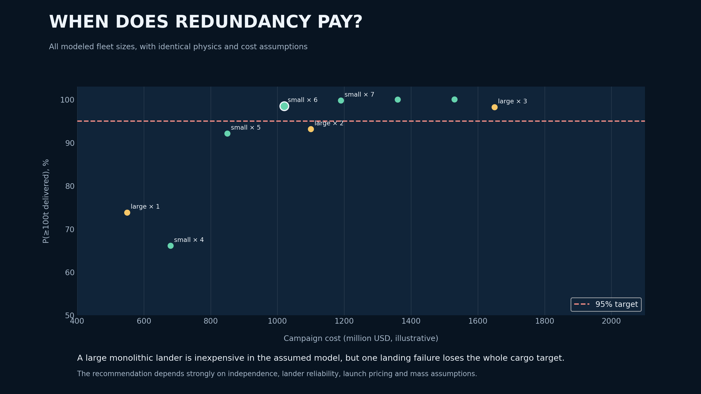

# MARS/100

**What's the best way to deliver 100 metric tons of cargo to Mars?**

A mission architecture trade study comparing direct 25-ton landers, a refueled 100-ton lander, and a redundant fleet of 25-ton landers. The project combines orbital transfer physics, rocket-equation sizing, cost modeling, reliability, and fleet optimization.


## Explore

- **[Interactive dashboard](dashboard.html)**: visualize the Earth–Mars transfer and adjust mission assumptions.
- **[Python model](model.py)**: run `python3 model.py` to reproduce the results and CSV exports.
- **[Slides](walkthrough.pdf)** · [PowerPoint](walkthrough.pptx) · [Narration](walkthrough_script.md)
- **[Sources and parameters](references.md)**

## Results

| Architecture | Campaign cost | Earth launches | P(deliver ≥100t) |
|---|---:|---:|---:|
| Four direct 25t landers | $680M | 4 | 66.1% |
| One refueled 100t lander | $550M | 5 | 73.8% |
| Six redundant 25t landers | $1.02B | 6 | 98.5% |

For a 95% campaign success requirement, the six-lander fleet is the least-cost qualifying configuration among those evaluated. Without that requirement, the refueled lander has the lowest campaign cost.

A simplified Hohmann transfer gives a **258.87-day** journey and a **3.59 km/s** trans-Mars injection burn from a 300-km circular low Earth orbit. The cost, mass, and landing-reliability parameters are editable scenario inputs.



## Run

```bash
python3 model.py
python3 -m pip install numpy matplotlib python-pptx
python3 make_figures.py
python3 make_slides.py
```

The dashboard is standalone HTML and runs locally without a server.

## References

See [references.md](references.md) for NASA/JPL sources and the model inputs.
