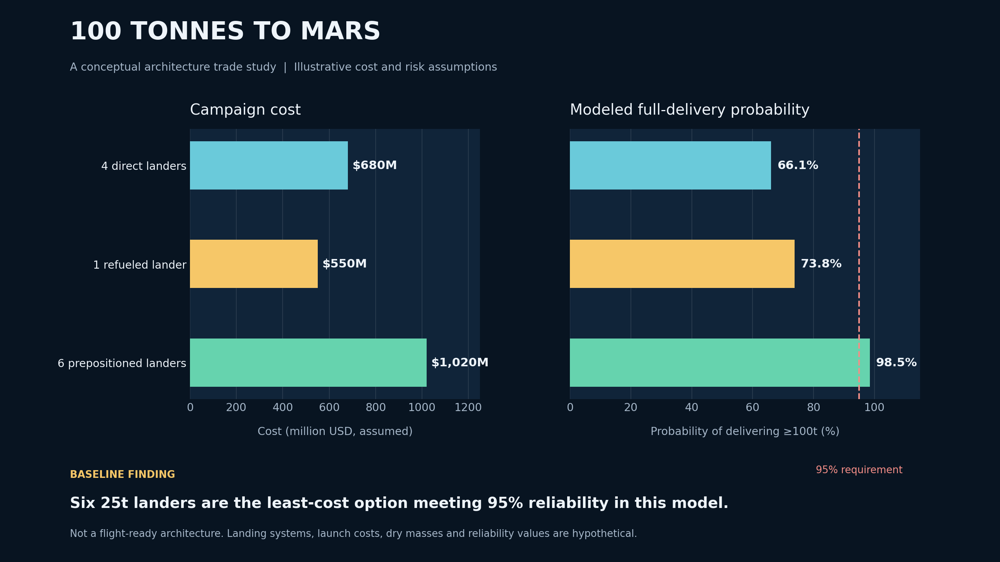

# MARS/100

**How should we deliver 100 metric tons of cargo to Mars?**

An interactive aerospace mission architecture study comparing direct launches, Earth-orbit refueling, and redundant cargo fleets. The model combines Hohmann transfer calculations, rocket-equation mass sizing, cost comparisons, and probabilistic fleet optimization.

## Explore the project

- **[Interactive dashboard](dashboard.html)** — open locally in any modern browser; play the orbital transfer animation and adjust cost, propulsion, and reliability parameters.
- **[Python model](model.py)** — run `python3 model.py` (standard library only) to reproduce the calculations and export `results.json` and CSV files.
- **[Presentation](walkthrough.pdf)** · [Editable slides](walkthrough.pptx) · [Narration](walkthrough_script.md)
- **[Sources](references.md)**

## Three mission architectures

| Architecture | Campaign cost | Earth launches | P(deliver ≥100t) |
|---|---:|---:|---:|
| Four direct 25t landers | $680M | 4 | 66.1% |
| One refueled 100t lander | $550M | 5 | 73.8% |
| Six redundant 25t landers | $1.02B | 6 | 98.5% |

**Result:** At a 95% campaign reliability threshold, the six-lander fleet is the lowest-cost qualifying option in the modeled design space. Without that threshold, orbital refueling has the lowest estimated campaign cost.

The model assumes independent landing outcomes, 92% small-lander entry/descent/landing success, 85% large-lander landing success, and simplified vehicle masses and launch costs. These parameters are configurable in the dashboard, and they strongly influence the recommendation.

## Orbital mechanics

For a circular, coplanar Earth–Mars transfer:

| Quantity | Calculated result |
|---|---:|
| Transfer duration | 258.87 days |
| Mars departure lead angle | 44.34° |
| Earth-to-Mars launch opportunity interval | ~780 days |
| Trans-Mars injection from 300 km LEO | 3.590 km/s |

The mass model applies the Tsiolkovsky rocket equation to trans-Mars injection and a modeled terminal descent maneuver. The fleet model uses exact binomial probabilities to determine the minimum-cost configuration meeting the cargo and success targets.

## What I explored

The most interesting trade-off was **cost versus reliability**. Orbital refueling wins on campaign cost, but modularity and extra landers improve the probability of completing the full cargo delivery objective. Increasing landing difficulty or changing tanker efficiency can shift the preferred mission architecture.

**Model boundary:** Costs, spacecraft specifications, and per-flight success rates are scenario inputs; orbital calculations use established two-body mechanics. See [references](references.md) for NASA/JPL sources and input details.

## Project files

| File | Contents |
|---|---|
| `dashboard.html` | Interactive browser-based trade study |
| `model.py` | Physics, fleet probability, optimization, and CSV exports |
| `make_figures.py` | Generate charts (`matplotlib`, `numpy`) |
| `make_slides.py` | Generate presentation (`python-pptx`) |
| `results.json` and `*.csv` | Calculated results and sensitivity study |
| `*.png` | Figures for reporting |
| `walkthrough.pdf`, `walkthrough.pptx` | Presentation files |
| `walkthrough_script.md` | 3–5 minute explanation |
| `references.md` | Sources and parameters |
